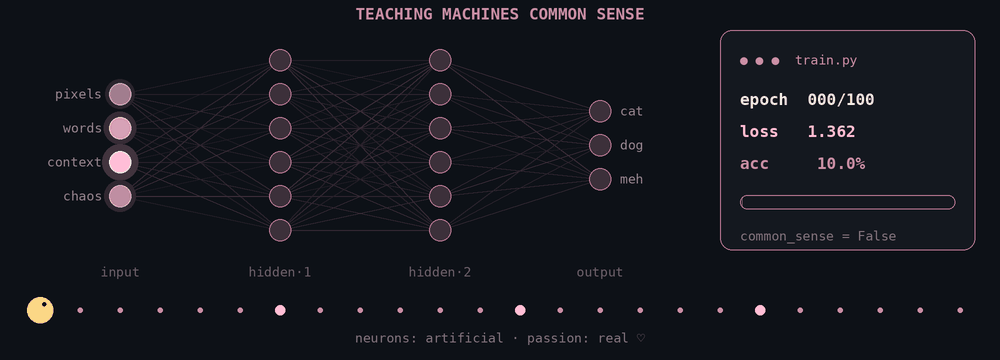

<!-- Replace YOUR_USERNAME / YOUR_LINKEDIN / YOUR_EMAIL / YOUR_PORTFOLIO -->

<p align="center">
  
</p>

<p align="center">
  
</p>


```console
emna@ai-lab:~$ whoami
AI Engineer · Data Scientist
 
emna@ai-lab:~$ cat mission.txt
Teaching machines common sense. Neurons: artificial. Passion: real.
 
emna@ai-lab:~$ ./now --verbose
[focus]    LangGraph multi-agent systems · neuro-symbolic AI · LLM evaluation
[studying] backpropagation · attention · knowledge graphs · RAG reranking
[status]   loss ↓  motivation ↑
```
<p align="center">
  
</p>

---


---

<p align="center"><b>GITHUB ANALYTICS</b></p>

<p align="center">
  
  
</p>

---


---

<p align="center">
  <a href="https://www.linkedin.com/in/https://www.linkedin.com/in/emna-driss-65603524b/"></a>
  <a href="mailto:driss.emna23@gmail.com"></a>
</p>

<p align="center">
  <sub><code>BUILD · EXPERIMENT · EVALUATE · ITERATE</code></sub>
</p>
